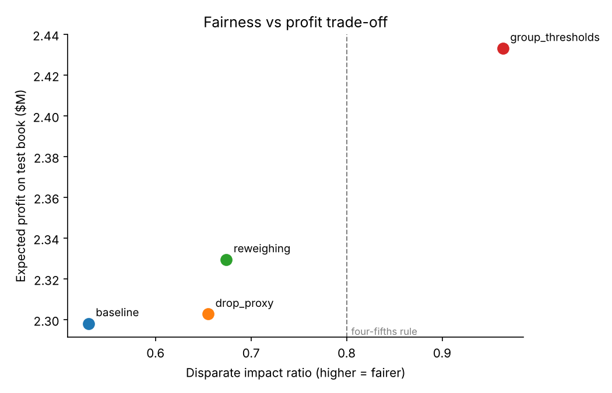

# Responsible AI in Finance: Credit Approval Audit

**An end-to-end audit of a credit-approval model covering fairness, explainability, robustness, and the
business and human impact of bias mitigation.**

[](https://github.com/hny-iitd/rai-finance-credit-fairness/actions)


Built on [rai-metrics-core](https://github.com/hny-iitd/rai-metrics-core).
Companion repo: [rai-healthcare-clinical-fairness](https://github.com/hny-iitd/rai-healthcare-clinical-fairness).

## Why this matters

Credit models decide who can buy a home, start a business or cover an emergency. Even when the protected
attribute is removed ("fairness through unawareness"), models can discriminate through **proxies**
(postcode as a stand-in for ethnicity) and **biased historical labels**. Regulators care about this:
* **US:** Equal Credit Opportunity Act / Regulation B (adverse-action notices, disparate impact), CFPB guidance on AI.
* **EU:** the AI Act classes creditworthiness scoring as **high-risk** (Annex III).
* **UK:** FCA Consumer Duty and its fair-treatment expectations.

## What the audit finds (synthetic data, default run)

| strategy | approval | book default rate | expected profit | disparate impact | equal-opportunity gap | creditworthy minority applicants denied |
|---|---|---|---|---|---|---|
| baseline | 42.8% | 7.9% | $2,298,216 | **0.530** ❌ | 0.242 | 888 |
| drop_proxy | 42.6% | 7.9% | $2,302,800 | 0.655 | 0.167 | 819 |
| reweighing | 41.8% | 7.6% | $2,329,584 | 0.674 | 0.153 | 817 |
| group_thresholds* | 42.4% | 7.3% | $2,433,252 | **0.964** ✅ | 0.000 | 660 |

<p align="center"></p>

**Takeaways**
1. The "unaware" baseline fails the four-fifths rule badly (DI = 0.53) and denies hundreds of minority applicants who would have repaid.
2. A **proxy scan** flags `neighbourhood_risk`; removing it is the single biggest lawful improvement.
3. **Reweighing** helps further, and in this data fairness and profit move together rather than trading off.
4. \*Group-specific thresholds close the gap completely, but they use the protected attribute at decision time,
   which can be unlawful disparate treatment under ECOA. They're included to show the size of the remaining gap, not as a recommendation.

See the full generated report: [`reports/REPORT.md`](reports/REPORT.md).

## What's measured

| Pillar | Metrics |
|---|---|
| Fairness | disparate impact (four-fifths rule), demographic parity, equal opportunity, equalized odds, predictive parity, calibration, intersectional (ethnicity × gender) |
| Impact | approval rate, book default rate, expected profit, creditworthy applicants denied, credit withheld ($) |
| Transparency | proxy-feature scan, permutation importance, **adverse-action reason codes** |
| Robustness | AUC under input noise, decision flip rate, population stability index (drift) |

## How the synthetic data encodes bias

`src/credit_fairness/data.py` generates 20,000 applicants with three documented mechanisms:
1. **Historical disadvantage:** shorter recorded credit histories and lower recorded income for the protected group.
2. **Proxy variable:** `neighbourhood_risk` correlates strongly with group membership (a digital echo of redlining).
3. **Label bias:** past predatory pricing inflated the group's recorded default rate.

No real individuals are represented.

## Run it

```bash
git clone https://github.com/GITHUB_USERNAME/rai-finance-credit-fairness.git
cd rai-finance-credit-fairness
pip install -e ".[dev]"
python -m credit_fairness.run          # regenerates reports/
pytest
```

Options: `--n 50000 --seed 1 --out my_reports`.

## Project layout
```
src/credit_fairness/
  data.py       synthetic lending data with injected bias
  pipeline.py   4 mitigation strategies + audit + adverse-action reasons
  impact.py     profit, default rate, access-to-credit metrics
  run.py        CLI → reports/REPORT.md + charts
tests/          pytest suite (runs in CI)
reports/        generated audit report and figures
```

## Limitations
* Synthetic data with illustrative economics (12% margin, 60% loss given default).
* A logistic regression is used deliberately for transparency; results differ for tree ensembles.
* Fairness thresholds are rules of thumb. Legal compliance needs legal review.

## License
MIT
