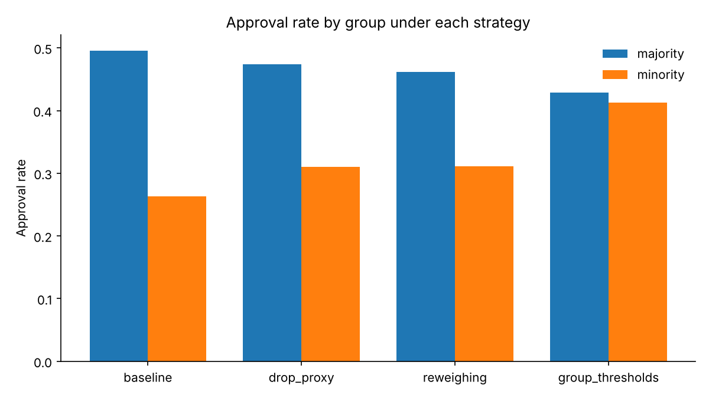
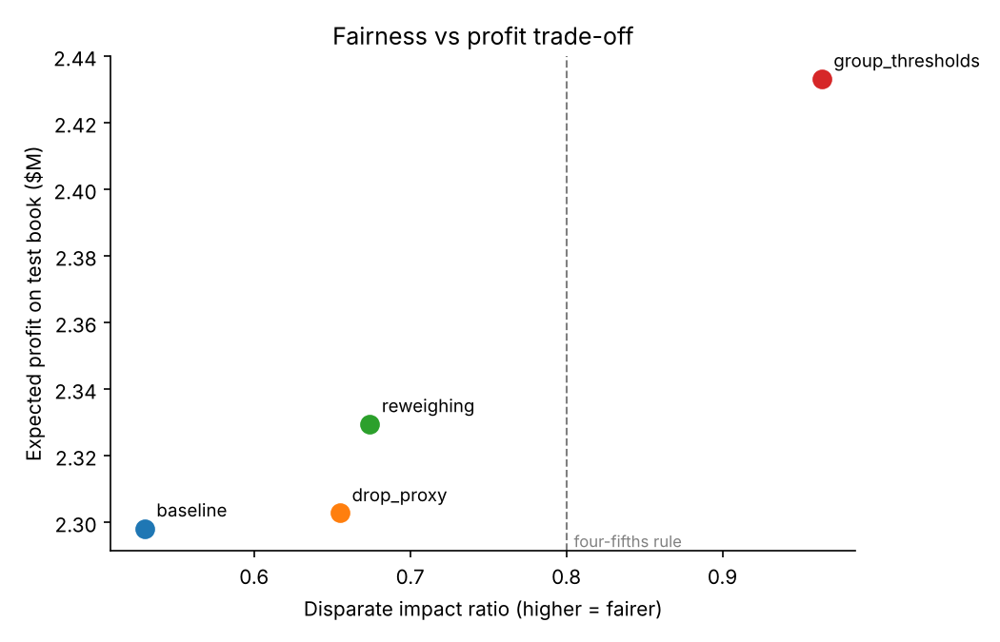

# Credit Approval: Responsible AI Audit Report

Synthetic portfolio of 20,000 applicants (6,000 in the audit set). Decision rule: approve when predicted
probability of default < 15%. Protected attribute (`ethnicity_group`) is never a model input.

## 1. Strategy comparison

| strategy         | approval_rate   | book_default_rate   | expected_profit_usd   |   disparate_impact |   equal_opportunity_gap |   creditworthy_minority_denied |
|:-----------------|:----------------|:--------------------|:----------------------|-------------------:|------------------------:|-------------------------------:|
| baseline         | 42.8%           | 7.9%                | $2,298,216            |              0.530 |                   0.242 |                            888 |
| drop_proxy       | 42.6%           | 7.9%                | $2,302,800            |              0.655 |                   0.167 |                            819 |
| reweighing       | 41.8%           | 7.6%                | $2,329,584            |              0.674 |                   0.153 |                            817 |
| group_thresholds | 42.4%           | 7.3%                | $2,433,252            |              0.964 |                   0.000 |                            660 |

## 2. Baseline fairness assessment

| metric                         |   value | threshold   | status   |
|:-------------------------------|--------:|:------------|:---------|
| demographic_parity_difference  |  0.2331 | <= 0.1      | FAIL     |
| disparate_impact_ratio         |  0.5299 | >= 0.8      | FAIL     |
| equal_opportunity_difference   |  0.2422 | <= 0.1      | FAIL     |
| false_positive_rate_difference |  0.1309 | <= 0.1      | FAIL     |
| false_negative_rate_difference |  0.2422 | <= 0.1      | FAIL     |
| equalized_odds_difference      |  0.2422 | <= 0.1      | FAIL     |
| predictive_parity_difference   |  0.0111 | <= 0.1      | PASS     |
| calibration_gap_ece            |  0.0093 | <= 0.1      | PASS     |

### Access to credit (baseline)

| ethnicity_group   |   applicants |   approval_rate |   creditworthy_denied |   creditworthy_denied_per_1000 |   credit_withheld_usd |
|:------------------|-------------:|----------------:|----------------------:|-------------------------------:|----------------------:|
| majority          |     4,257.00 |            0.50 |              1,485.00 |                         348.84 |         23,986,500.00 |
| minority          |     1,743.00 |            0.26 |                888.00 |                         509.47 |         13,710,400.00 |

### Intersectional approval rates (ethnicity × gender, baseline)

|                 |   approval_rate |
|:----------------|----------------:|
| minority|female |           0.240 |
| minority|male   |           0.285 |
| majority|female |           0.483 |
| majority|male   |           0.507 |

## 3. Transparency

**Proxy scan.** How well each feature alone predicts group membership (strength 0 = no signal, 1 = perfect proxy):

| feature              |   proxy_auc |   proxy_strength |
|:---------------------|------------:|-----------------:|
| neighbourhood_risk   |       0.951 |            0.903 |
| income_k             |       0.384 |            0.232 |
| credit_history_years |       0.389 |            0.221 |
| debt_to_income       |       0.580 |            0.161 |
| loan_amount_k        |       0.484 |            0.031 |
| employment_years     |       0.492 |            0.017 |
| delinquencies_2y     |       0.502 |            0.004 |

**Permutation importance** (drop in AUC when the feature is shuffled):

| feature              |   importance_mean |   importance_std |
|:---------------------|------------------:|-----------------:|
| income_k             |            0.1182 |           0.0057 |
| debt_to_income       |            0.0384 |           0.0047 |
| delinquencies_2y     |            0.0106 |           0.0014 |
| neighbourhood_risk   |            0.0015 |           0.0003 |
| credit_history_years |            0.0010 |           0.0003 |
| loan_amount_k        |            0.0007 |           0.0008 |
| employment_years     |            0.0000 |           0.0000 |

**Adverse-action reason codes** (reweighing model, first denied applicants):

|    |   applicant_index |   p_default | principal_reasons                          |
|---:|------------------:|------------:|:-------------------------------------------|
|  0 |             10414 |       0.165 | income_k, delinquencies_2y                 |
|  1 |             13053 |       0.202 | income_k, debt_to_income, employment_years |
|  2 |             17205 |       0.179 | debt_to_income, delinquencies_2y, income_k |
|  3 |             11110 |       0.261 | income_k, delinquencies_2y, debt_to_income |
|  4 |             12185 |       0.255 | income_k, debt_to_income, employment_years |

## 4. Robustness & monitoring

|   noise_level |    auc |   auc_drop |
|--------------:|-------:|-----------:|
|        0.0000 | 0.7519 |     0.0000 |
|        0.0500 | 0.7509 |     0.0011 |
|        0.1000 | 0.7509 |     0.0010 |
|        0.2000 | 0.7486 |     0.0034 |
|        0.3000 | 0.7424 |     0.0096 |

* Decision flip rate under 5% input noise: **1.45%**
* Population Stability Index, income (train → test): **0.0029** (< 0.1 is stable)

## 5. Impact summary

* The baseline model denies **888** creditworthy minority applicants
  (509 per 1,000 minority applicants), withholding
  **$13,710,400** of credit from people who would have repaid.
* Disparate impact ratio moves from **0.53** (baseline) to
  **0.67** with the best attribute-blind strategy (`reweighing`),
  with a profit change of
  **+1.4%**.
  It still fails the four-fifths rule, so further work (better features, alternative data, a fairness-constrained model) is needed.
* `group_thresholds` uses the protected attribute at decision time. That equalises opportunity but can be
  unlawful disparate treatment in US consumer lending (ECOA / Reg B), so it is shown for analysis only.

_All data is synthetic. Figures illustrate methods and are not evidence about any real lender._
